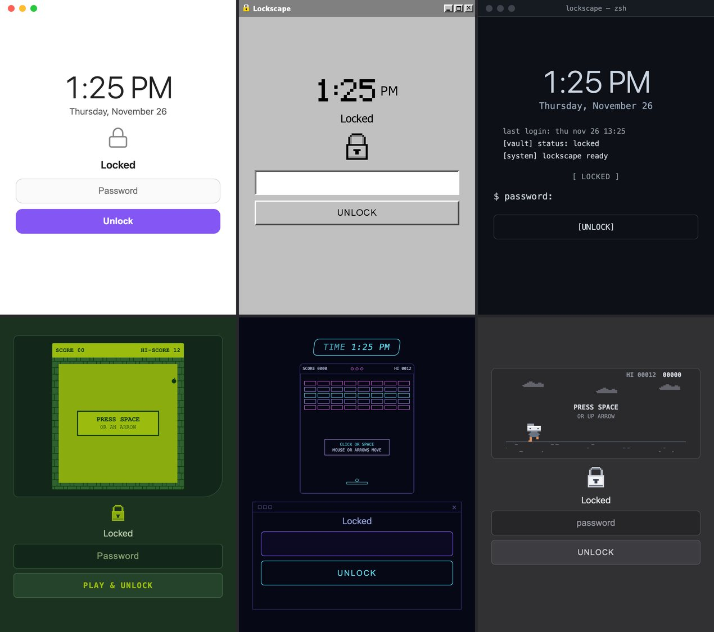

# Lockscape

[English](README.md) · 한국어

macOS와 Windows용 [Obsidian](https://obsidian.md) 비밀번호 잠금 화면 플러그인입니다. 앱을 켤 때, 자리를 비웠을 때, 다른 앱으로 넘어갈 때 노트를 가립니다. 잠금 화면은 원하는 대로 꾸밀 수 있습니다. 테마 6종(오프라인 게임 3종 포함), 내 사진이나 영상, 시계, 가벼운 애니메이션을 고를 수 있습니다.

> ⚠️ **Lockscape는 화면 잠금이며 암호화가 아닙니다.**
> 자리를 비운 사이 옆 사람이 켜져 있는 Obsidian을 쓰지 못하게 막습니다. 노트 파일은 **암호화하지 않습니다.** 볼트 폴더를 열 수 있는 사람은 `.md` 파일을 읽을 수 있습니다. 컴퓨터를 잃어버리거나 도난당하는 상황에는 FileVault(macOS)나 BitLocker(Windows)를 쓰세요. 자세한 내용은 [보안 문서(영문)](docs/SECURITY.md)에 있습니다.

## 기능

- **원하는 때 잠금**: 시작할 때, 1~60분 동안 입력이 없을 때, 앱을 벗어날 때, 컴퓨터가 잠기거나 절전될 때, 직접 잠글 때(리본 아이콘 또는 명령).
- **유예 시간**: 30초 안에 돌아오면 비밀번호를 묻지 않습니다. 시간은 바꾸거나 끌 수 있습니다.
- **테마 6종**: 기본, Windows 95, 개발자 터미널, 그리고 잠금 화면에서 하는 오프라인 게임 3종(게임보이 스네이크, 아케이드 벽돌깨기, 폴더 러너). 게임별 최고 점수를 저장합니다.
- **꾸미기**: 사진이나 짧은 반복 영상 배경, 어둡게와 흐리게, 애니메이션(일부는 마우스를 따라옵니다), 시계 크기와 글꼴, 색, 입력창 모양. **미리보기**로 잠그지 않고 확인합니다.
- **복구 키**: 비밀번호를 정하면 적어 둘 무작위 키가 나옵니다. 비밀번호를 잊으면 잠금 화면의 *비밀번호를 잊으셨나요?* 에서 이 키로 풉니다.
- **화면 가리기**: 화면 공유 직전처럼 바로 가려야 할 때 쓰는 명령입니다. 잠금이 아니라서 클릭하거나 Esc를 누르면 다시 보입니다.
- **포커스를 잃으면 가리기**(선택): 다른 앱이 앞에 오는 순간 노트를 가립니다.
- **잠금 중 창 줄이기**(선택): 잠근 동안 Obsidian 창을 작게 줄이고, 풀면 원래 크기와 위치로 돌립니다.
- **입력창 숨기기**(선택): 마우스를 올리거나 키를 누를 때까지 비밀번호 입력창을 숨깁니다.
- **잠금 화면 할 일**(선택): 잠긴 상태에서 할 일을 추가하고 체크합니다. **비밀번호 없이 보입니다.**
- **최근 기록**: 잠금, 해제, 비밀번호 오류 50건을 설정에서 확인합니다.
- **이 기기 전용 설정**: 자동 잠금 시간 같은 옵션을 이 컴퓨터에만 저장합니다.
- **10개 언어**: Obsidian의 언어 설정을 따릅니다. 번역은 아직 원어민 검수 전입니다.

## 설치

**커뮤니티 디렉터리에서**: [Lockscape 페이지](https://community.obsidian.md/plugins/lockscape)에서 **Add to Obsidian**을 누릅니다. 앱에서는 설정 → 커뮤니티 플러그인 → 탐색에서 *Lockscape*를 검색해 설치하고 켭니다.

**직접 설치**: [최신 릴리스](https://github.com/BeautyKim/Lockscape/releases/latest)에서 `main.js`, `manifest.json`, `styles.css`를 받아 `<볼트>/.obsidian/plugins/lockscape/`에 넣고, 설정 → 커뮤니티 플러그인에서 **Lockscape**를 켭니다.

Obsidian 1.13.0 이상이 필요합니다. 그보다 낮은 버전에는 1.8.7부터 지원하는 0.1.2가 제공됩니다. PC 전용입니다(macOS, Windows).

## 시작하기

1. 설정 → **Lockscape**에서 비밀번호를 정합니다(4자 이상, 8자 이상 강력히 권장).
2. **복구 키**가 한 번만 표시됩니다. 적어서 이 컴퓨터와 떨어진 곳에 보관하세요.
3. *잠금 화면 꾸미기*에서 테마와 배경을 고르고 **미리보기**로 확인합니다.
4. 리본의 자물쇠 아이콘이나 **Lockscape: 지금 잠그기** 명령으로 잠급니다.

## 주요 설정

| 설정 | 하는 일 |
|---|---|
| 시작할 때 잠금 | Obsidian을 켤 때 노트가 그려지기 전에 잠급니다 |
| 자동 잠금(미사용 시간) | 사용 안 함, 또는 마우스·키보드·터치 입력이 1, 5, 10, 15, 30, 60분 없으면 잠급니다 |
| 앱을 벗어나면 잠금 / 유예 시간 | 창이 가려지거나 최소화되면 화면을 가립니다. 유예 시간 안에 돌아오면 비밀번호를 묻지 않습니다 |
| 창이 포커스를 잃으면 가리기 | Obsidian이 보여도 다른 앱이 앞에 있으면 가립니다 |
| 컴퓨터가 잠기거나 절전되면 잠금 | 운영체제의 화면 잠금·절전 신호를 받아 잠급니다 |
| 이 기기 전용 설정 | 자동 잠금 관련 옵션을 동기화하지 않고 이 컴퓨터에 둡니다 |
| 복구 키 | 만들거나 새로 만듭니다(현재 비밀번호 확인) |
| 잠금 화면 꾸미기 | 테마, 배경(없음·사진·영상), 애니메이션, 시계, 글자 색과 강조 색, 배치, 입력창 모양 |
| 잠금 중에는 창 작게 만들기 | 창 크기 380×520, 460×620, 560×720, 660×820 |

## 비밀번호를 틀리거나 잊었을 때

- 5번째로 틀리면 30초 동안 입력할 수 없습니다. 이후 틀릴 때마다 두 배가 되고 최대 15분입니다. 앱을 다시 켜도 유지됩니다.
- **비밀번호를 잊었다면**: 잠금 화면에서 *비밀번호를 잊으셨나요?* 를 누르고 복구 키를 입력한 뒤 새 비밀번호를 정합니다. 대소문자, 띄어쓰기, 하이픈은 상관없습니다. 새 복구 키가 발급됩니다.
- **둘 다 잃었다면**: 재설정 링크, PIN, 마스터 비밀번호는 일부러 두지 않았습니다. 볼트 폴더에 접근할 수 있으면 `data.json`을 고쳐 잠금을 없앨 수 있습니다. 절차는 [보안 문서(영문)](docs/SECURITY.md)에 있습니다.

## 개인정보와 공개 항목

- **네트워크**: 요청을 보내지 않습니다. 사용 정보 수집과 광고가 없고, 스스로 설치하거나 업데이트하지 않으며, 코드를 난독화하지 않았습니다.
- **파일**: 자기 플러그인 폴더(`data.json`, 고른 배경 사진·영상의 사본)만 읽고 씁니다. 그 밖에는 파일 선택창에서 직접 고른 파일 하나를 읽습니다. 노트는 읽지 않습니다.
- **`data.json`에 담기는 것**: 비밀번호와 복구 키의 솔트 해시(PBKDF2, 평문 아님), 설정, 실패 횟수, 최근 기록, 할 일(평문), 게임 최고 점수. 플러그인 폴더를 동기화하면 함께 동기화됩니다.
- **데스크톱 API**: Electron의 일부 기능을 써서 PC 전용입니다. 잠겨 있거나 화면을 가린 동안에는 **열린 창 목록을 확인해, 잠금 화면이 덮지 못하는 이 볼트의 창을 숨깁니다**(설정, 커뮤니티 플러그인 탐색처럼 Obsidian이 따로 여는 창). 잠금을 풀면 다시 보여 줍니다. 창을 닫거나 내용을 읽지 않고, 다른 볼트의 창은 건드리지 않습니다. 선택 기능인 *창 줄이기*와 *컴퓨터 잠금·절전 시 잠금*은 창·전원 객체를 씁니다.
- **클립보드**: 읽지도 쓰지도 않습니다. 복구 키는 선택한 뒤 Cmd/Ctrl+C로 복사합니다.
- **계정과 결제**: 필요 없습니다. 무료 오픈 소스입니다.

## 자주 묻는 질문

**노트를 암호화하나요?** 아니요. 위의 경고를 확인하세요.

**플러그인을 그냥 끌 수 있지 않나요?** 볼트 폴더를 고칠 수 있거나, 잠기지 않은 Obsidian에서 설정을 바꿀 수 있는 사람은 가능합니다. Lockscape는 잠그는 순간 설정 창과 비밀번호 창을 닫고, 잠금 화면 뒤의 단축키를 막고, 팝아웃 창을 가립니다. 설정이나 커뮤니티 플러그인 탐색처럼 덮을 수 없는 창은 잠긴 동안 숨깁니다. 잠근 뒤에 메뉴 막대로 연 창도 숨깁니다. 새 창은 200ms 간격으로 확인하므로 숨기기 전에 아주 잠깐 보일 수 있습니다. 0.1.7보다 낮은 버전은 이 창들을 숨기지 않으니 업데이트해 주세요. 파일에 접근할 수 있는 사람까지는 앱 안의 잠금으로 막을 수 없습니다.

**잠금 화면에서 게임을 해도 안전한가요?** 게임은 잠금 화면에서만 오프라인으로 돌고, 입력하는 비밀번호를 읽지 않습니다. Tab으로 입력창에 가면 키가 입력창으로만 가고, Esc로 게임에 돌아옵니다.

**비밀번호 4자로 충분한가요?** 내 자리에서 직접 입력해 보는 사람은 막습니다. 5번 틀리면 기다려야 하기 때문입니다. `data.json` 사본을 가진 사람은 막지 못합니다. 그 대기 없이 짧은 조합을 모두 대입해 볼 수 있습니다. 볼트 폴더를 동기화하거나 공유한다면 8자 이상을 쓰세요. 복구 키는 120비트 무작위 값이라 이렇게 알아낼 수 없습니다.

## 더 보기 (영문)

- [보안 문서](docs/SECURITY.md): 감사 사실표, 위협 모델, 수동 복구
- [꾸미기](docs/CUSTOMIZING.md): CSS 훅과 배경 영상
- [개발](docs/DEVELOPMENT.md): 빌드, 테스트, 릴리스

Windows 95 테마는 직접 만든 오마주입니다. Lockscape는 Microsoft나 Obsidian과 관련이 없고 두 회사의 보증을 받지 않습니다.

## 후원

☕ [GitHub Sponsors](https://github.com/sponsors/BeautyKim) · [Ko-fi](https://ko-fi.com/beauty_kim)

## 라이선스

[MIT](LICENSE)
