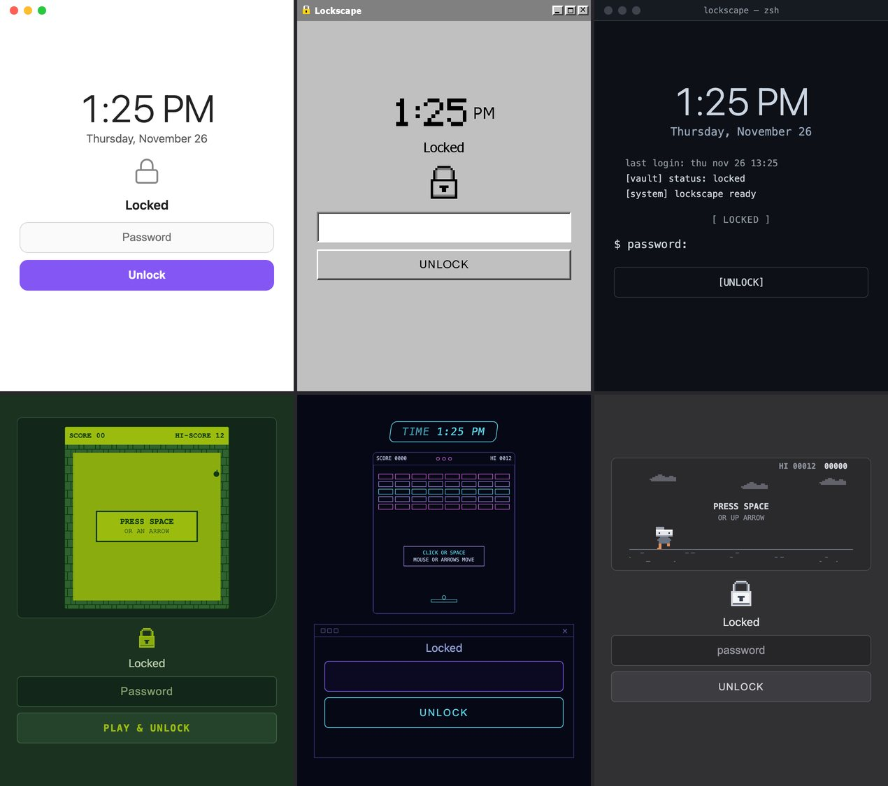

# Lockscape

English · [한국어](README.ko.md)

A password lock screen for [Obsidian](https://obsidian.md) on macOS and Windows. It covers your notes when you start the app, when you walk away, and when you switch to another app, and you decide how the lock screen looks: six themes (including three small offline games), your own photo or video, a clock, a light animation.

> ⚠️ **Lockscape is a screen lock, not encryption.**
> It keeps a colleague or passer-by from using your unlocked, unattended Obsidian. It does **not** encrypt your notes. Anyone who can open the vault folder can read the `.md` files. For a lost or stolen computer, use FileVault (macOS) or BitLocker (Windows). Details: [Security notes](docs/SECURITY.md).

## Features

- **Locks when you want it to**: on startup, after 1 to 60 minutes without activity, when you leave the app, when the computer locks or sleeps, or by hand (ribbon icon or command).
- **Grace period**: leave and come back within 30 seconds (adjustable, or off) and no password is asked.
- **Six themes**: Default, Windows 95, developer terminal, and three offline games to play on the lock screen: handheld snake, neon breakout, folder runner. Each saves its best score.
- **Your own look**: a photo or a short looping video as the background, dimming and blur, seven animations (some follow the mouse), clock size and font, colours, field shape. A **Preview** button shows the result without locking.
- **Recovery key**: when you set a password you get a random key to write down. If you forget the password, *Forgot your password?* on the lock screen unlocks with it.
- **Hide screen**: a command that covers everything at once, for example before you share your screen. It is not a lock: click or press Esc to show it again.
- **Cover on focus loss** (optional): cover the notes as soon as another app is in front.
- **Shrink window while locked** (optional): the Obsidian window gets small while locked and returns to its exact size and place on unlock.
- **Hide the password field** (optional) until you hover or type.
- **Lock-screen to-dos** (optional): add and tick items while locked. They are visible without the password.
- **Activity log**: the last 50 locks, unlocks and wrong passwords, in the settings.
- **Separate settings per computer**: keep auto-lock time and the other leave-the-app options local to one machine.
- **10 languages**: English, 한국어, 日本語, 简体中文, 繁體中文, Español, Français, Deutsch, Português (BR), Русский (follows Obsidian's language; translations are not yet reviewed by native speakers).

## Install

**From the community directory**: open the [Lockscape page](https://community.obsidian.md/plugins/lockscape) and choose **Add to Obsidian**, or in the app go to Settings → Community plugins → Browse, search for *Lockscape*, then Install and Enable.

**Manually**: download `main.js`, `manifest.json` and `styles.css` from the [latest release](https://github.com/BeautyKim/Lockscape/releases/latest) into `<your vault>/.obsidian/plugins/lockscape/`, then enable **Lockscape** under Settings → Community plugins.

Requires Obsidian 1.13.0 or newer (older apps are offered version 0.1.2, which supports 1.8.7). Desktop only (macOS and Windows).

## Getting started

1. Open Settings → **Lockscape** and choose **Set password** (at least 8 characters).
2. A **recovery key** appears once. Write it down and keep it away from this computer.
3. Pick a theme and a background under *Lock screen appearance*, and press **Preview** to see it.
4. Lock with the padlock in the ribbon or the command **Lockscape: Lock now**.

## Settings at a glance

| Setting | What it does |
|---|---|
| Lock on startup | Locks as Obsidian starts, before your notes are drawn |
| Auto-lock | Off, or after 1, 5, 10, 15, 30 or 60 minutes without mouse, keyboard or touch input |
| Lock when leaving the app / grace period | Covers the screen when the window is hidden or minimised; coming back inside the grace period needs no password |
| Cover when the window loses focus | Also covers when another app is in front, even if Obsidian is still visible |
| Lock when the computer locks or sleeps | Locks on the operating system's lock-screen and sleep events |
| Separate settings on this device | Keeps the auto-lock options of this computer local; they are not synced |
| Recovery key | Create or replace the recovery key (asks for the current password) |
| Appearance | Theme, background (none, photo, video), animation, clock, text and accent colour, layout, field shape |
| Shrink window while locked | Window size 380×520, 460×620 or 560×720 while locked |

## Wrong passwords and recovery

- Five free tries, then a 30 second wait that doubles with each further failure, up to 15 minutes. The count survives restarts.
- **Forgot the password?** On the lock screen choose *Forgot your password?*, type the recovery key (case, spaces and dashes do not matter), then pick a new password. You get a new recovery key.
- **Lost both?** There is no reset link, PIN or master password by design. With access to the vault folder you can remove the lock by editing `data.json`; the steps are in the [Security notes](docs/SECURITY.md).

## Privacy and disclosures

- **No network**: Lockscape makes no network requests, has no telemetry, shows no ads, installs or updates nothing by itself, and is not obfuscated.
- **Files**: it reads and writes only its own plugin folder (`data.json`, and a copy of the background photo or video you pick) and reads the one file you choose in the system file picker. It does not read your notes or anything else.
- **What `data.json` holds**: the password and recovery key as salted PBKDF2 hashes (never in plain text), your settings, the failed-attempt counter, the activity log, to-do items (plain text) and game best scores. It syncs with your vault if you sync the plugin folder.
- **Desktop APIs**: the optional *shrink window* and *lock when the computer locks or sleeps* features use Electron's window and power-monitor objects, which is why the plugin is desktop only.
- **Clipboard**: Lockscape neither reads nor writes it. To copy the recovery key, select it and press Cmd/Ctrl+C.
- **Account or payment**: none needed. Free and open source.

## FAQ

**Does it encrypt my notes?** No. See the warning above.

**Can someone just turn the plugin off?** Anyone who can edit the vault folder, or the plugin settings while Obsidian is unlocked, can. Lockscape closes the settings window and any password dialog the moment it locks, blocks Obsidian's hotkeys behind the lock screen, and covers pop-out windows too. A lock inside an app cannot stop someone with file access.

**Are the games safe to play on a lock screen?** They run only on the lock screen, offline, in plain canvas code, and never read the password you type. Keys go to the password field when it has focus (Tab moves there, Esc gives the keyboard back to the game).

**Why a recovery key and not a PIN?** A PIN is short enough to guess offline from a copy of `data.json`. The recovery key has 120 random bits.

## More

- [Security notes](docs/SECURITY.md): audit facts, threat model, recovery by hand
- [Customising](docs/CUSTOMIZING.md): CSS hooks and background clips
- [Development](docs/DEVELOPMENT.md): build, tests, releasing

The Windows 95 theme is a visual homage made from scratch. Lockscape is not affiliated with or endorsed by Microsoft or Obsidian.

## Support

☕ [GitHub Sponsors](https://github.com/sponsors/BeautyKim) · [Ko-fi](https://ko-fi.com/beauty_kim)

## License

[MIT](LICENSE)
